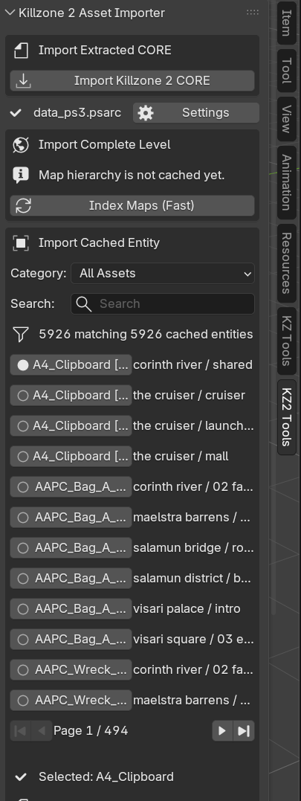
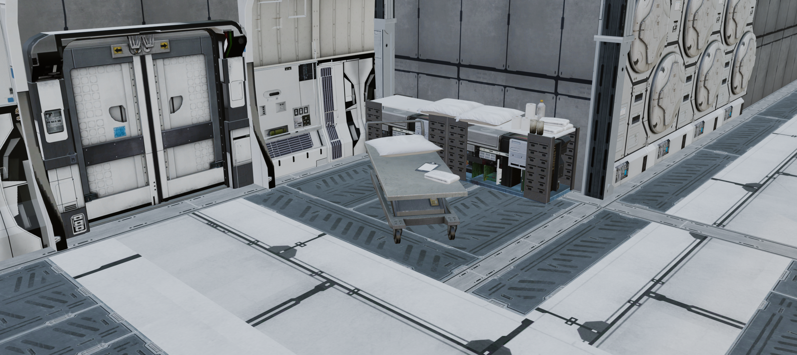
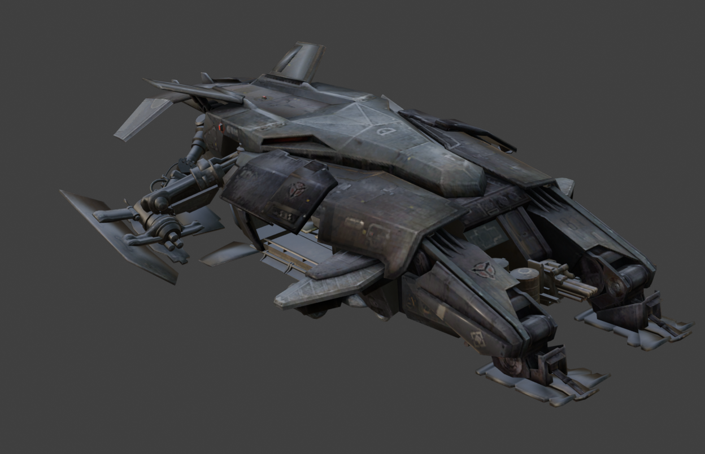
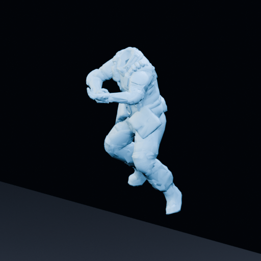

# Killzone 2 Blender importer

Blender 5.2 extension for independently decoded assets from the US retail
release of Killzone 2 (`BCUS98116`, app/disc version `01.01`,
`RTTIBin<1.58>`).

No game data is included. Use this extension only with data you are legally
entitled to inspect.

## Technical format documentation

Reverse-engineered notes for analysts and technical artists are available in
the [file-format documentation](docs/README.md). The notes cover PSARC, CORE,
geometry, textures, materials, levels, entities, skeletons, and animation, and
explicitly distinguish validated behavior from guesses and unknown fields.

## Current support

| Capability | Status |
|---|---|
| Extracted `.core` files | Supported |
| Static triangle meshes and normalized-position reconstruction | Supported |
| Packed vertex streams, normals, tangents, and UVs | Supported |
| Expanded rest skeletons | Supported |
| ES00 animation fallback poses and parent hierarchy | Supported |
| Compact skinned vertices and three-weight skinning | Supported |
| Packed KZ2 `EA02` rotation, translation, and scale tracks | Supported |
| Blender Actions with native clip timing | Supported for CORE and compatible cached entities |
| Retail 2D texture formats (`RGBA8`, DXT1/3/5, RGBA16F) | Supported |
| Local render-effect graphs and profile-driven preview materials | Supported |
| Named sampler nodes, source color spaces, and 64x1 ramps | Supported |
| Packed YUV lightmap reconstruction with separate sun occlusion | Supported |
| Local object references | Supported |
| PSARC catalog/extraction library | Supported in the pure-Python API |
| All 44 retail level direct serializers | Supported with exact framing |
| Recursive big-endian Lua 5.1 `GameScript` structure | Supported, never executed |
| Static map placements and parent transforms | Supported |
| Entity placeholder props and destructible model parts | Supported |
| Persistent PSARC entity catalog and sidebar import | Supported |
| Campaign/MP map hierarchy and direct PSARC level import | Supported |
| Complete-map and individual-section collections | Supported |
| Dedicated skybox geometry in level manifests | Supported |
| Cached skinned entities with armatures and weights | Supported |
| Blender-correct Z-up map orientation | Supported |
| LOD, multi-mesh, and switch wrappers | Supported |
| Per-instance lightmap textures and `LMUVShift` | Supported |
| Exact-ID external textures, buffers, effects, and shaders | Supported with a source PSARC |
| Cubemap parsing and face/mip preservation | Supported in the pure-Python API |
| Cubemap conversion to Blender environments | Not yet mapped |
| Gameplay entities, collision, particles, lights, zones, and AI records | Parsed as typed metadata; not all have Blender adapters |
| Scalar/user animation channels | Parsed and reported, not mapped |

## Install

1. Build or download `io_scene_killzone2.zip`.
2. In Blender 5.2, open **Edit > Preferences > Get Extensions**.
3. Use **Install from Disk** and select the ZIP.
4. Enable **Killzone 2 Asset Importer** if Blender does not enable it
   automatically.

To build the ZIP from this repository:

```powershell
python .\tools\build_extension.py
```

The build is written to `.\dist\io_scene_killzone2.zip`.

## Import

Open **3D View > Sidebar > KZ2 Tools** for the extension's dedicated menu.
The sidebar can still launch the extracted CORE file picker. It also provides
complete level, individual section, and cached entity import directly from
`data_ps3.psarc`.



To cache importable assets and maps:

1. Open the KZ2 Tools sidebar and choose **Settings**.
2. Select the matching authorized retail `data_ps3.psarc`.
3. Run **Scan / Rescan Assets and Maps** once.
4. Use **Import Complete Level** to choose Campaign or Multiplayer, select a
   map and section, then choose **Import Entire Map** or **Import Section**.
5. To import one entity instead, choose a category, optionally search by asset
   name or source map, select a result, and choose **Import Entity**.

The level browser contains all 10 campaign levels and all 8 retail multiplayer
maps. Campaign entries expose the exact `LevelSection` hierarchy and enabled
lumps from the optimized root manifest rather than grouping files only by path
name. Whole-map imports deduplicate COREs shared by multiple sections and put
them in a **Shared** child collection. Section-specific geometry is placed in
named child collections. The **Skybox Geometry** option is enabled by default
and includes dedicated skybox COREs such as the Corinth River/The New Sun and
The Cruiser skies.

Level imports include supported direct `StaticMeshInstance` environment
placements and mesh-backed `EntityPlaceHolder` props. Materials and textures,
entity props, skybox geometry, UV flipping, and scale can be controlled in the
sidebar. Gameplay scripts are never executed, and parsed collision, lights,
particles, zones, audio, and AI metadata do not yet all have Blender object
adapters.



*Imported level geometry with placed props and preview materials.*

The cached-entity browser groups results into maps/environment, characters,
vehicles, weapons, props, and other assets. It displays 12 results per page
with first, previous, next, and last-page controls. Duplicate names include a
compact source map/section label so map-local variants remain distinguishable.



*A cached rigged entity imported with its material preview.*

> [!WARNING]
> The first scan may take several minutes because the archive contains thousands
> of CORE entries. Expect it to take longer when `data_ps3.psarc` is on an
> external USB drive. Later entity selection uses the persisted cache and does
> not repeat the scan unless you explicitly rescan or the archive changes.


Complete levels can contain hundreds of megabytes of optimized CORE data and
thousands of placements, so an entire-map import can take several minutes.
Import one section first when validating settings. The importer opens the
PSARC once, reuses the persistent SQLite dependency resolver and mesh-template
caches, and imports each physical CORE only once even when multiple sections
reference it.


### Cached entity animations

When **Animations** is enabled, a cached entity import creates Actions for
EA02 clips whose `SkeletonAnimationBoneMap` exactly matches one imported
armature. Actions use the game animation-state name when available and have a
fake user so inactive clips remain in the `.blend` file.



*Full-body EA02 animation played from an imported Blender Action.*

For `HGH_Dropship [45]`, the body rig imports these Actions:

- `HGH_Dropship - Hover`
- `HGH_Dropship - Neutral`
- `HGH_Dropship - Approach`
- `HGH_Dropship - Fly Away`

To view one, select the dropship armature (`Skeleton_342`), change a Dope
Sheet editor to **Action Editor**, and select the Action from its dropdown.
The importer now leaves this armature selected at frame 1. The last compatible
imported clip is active immediately after import.


## Pure-Python API

The binary readers do not import `bpy`:

```python
from io_scene_killzone2.kz2_assets import CoreDecoder, CoreFile, Psarc

archive = Psarc.open(r"E:\path\to\data_ps3.psarc")
entry = archive.get("LocalCachePS3/lumps/example.core")
core = CoreFile.from_bytes(archive.read_entry(entry), source=entry.path)
decoder = CoreDecoder(core)
```

Decoded texture payloads can also be accessed without Blender:

```python
from io_scene_killzone2.kz2_assets.model import Texture
from io_scene_killzone2.kz2_assets.textures import decode_texture_surface

for record, texture in decoder.iter_type("Texture"):
    if isinstance(texture, Texture) and texture.texture_type == 0:
        surface = decode_texture_surface(texture)
        print(record.display_id, surface.width, surface.height)
```

## Tests

Synthetic tests contain no copyrighted game payload:

```powershell
python -m unittest discover -s .\tests -v
```

Optional private integration tests use the local archive without copying any
asset into this repository:

```powershell
$env:KZ2_PSARC = "E:\path\to\data_ps3.psarc"
python -m unittest .\tests\test_local_archive.py -v
```

### Full retail archive audit

Developers can audit every physical `.core` entry without extracting or
writing game assets:

```powershell
python .\tools\audit_retail_archive.py `
  "E:\path\to\data_ps3.psarc" `
  --output .\kz2-audit.json
```

The deterministic JSON report contains aggregate type, reference, animation,
skinning, framing, and decoder diagnostics. It includes logical asset paths
and object metadata for failures, but no serialized payloads or decoded game
assets. The command exits nonzero if a CORE cannot be framed or a registered
decoder rejects an object. Use `--structure-only` for a faster framing pass,
or omit the positional path after setting `KZ2_PSARC`.

## Known limitations

- Only the `BCUS98116 01.01` / `RTTIBin<1.58>` profile is accepted.
- All 44 confirmed retail level direct classes are framed and retained.
  Static render placements and mesh-backed entity props create visual
  Blender objects. Collision, particles, lights, portals, zones, cameras,
  scripts, and AI/navigation records remain typed metadata for later
  adapters.
- Entity/model render links and state-based destructibility model parts are
  decoded. The full selected-section dependency graph and gameplay behavior
  are not; ambiguous exact class/name resources therefore remain visible
  diagnostic empties instead of selecting an arbitrary definition.
- LOD and switch source order, keys, and distances are preserved. Blender
  initially hides non-primary variants because the exact runtime LOD
  comparison, equality behavior, distance origin, and distance unit remain
  unproven.
- Render-effect graphs are preserved, but compiled PS3 shaders are not
  generally translated into equivalent Blender shaders. Proven profiles
  select representative base color and opacity inputs, and static packed
  lightmaps are reconstructed. Profile-specific normal signs, packed
  specular channels, response-ramp coordinates, emissive effects, and IBL
  paths remain unconnected until their shader arithmetic is validated.
- Cubemap faces and mips are parsed but are not yet converted from the
  game's Y-up face basis to Blender environment images.
- Blend targets, collision shapes, render probes, and gameplay-specific
  direct records are not yet instantiated as specialized Blender data.
- Scalar/user animation channels are not yet mapped to custom properties,
  materials, or shape keys. Clips containing only those channels are skipped.
- `SkeletonAnimationBoneMap` semantics are only partially understood. The
  current importer uses the validated direct Edge joint-index order and
  requires matching metadata when reusing an existing armature.
- Additive and composite animation semantics have not been proven. Decoded
  transform clips are currently applied as absolute local transforms.
- Unknown `EA02` flags and unsupported format revisions fail closed rather
  than creating incomplete or fabricated Actions.
